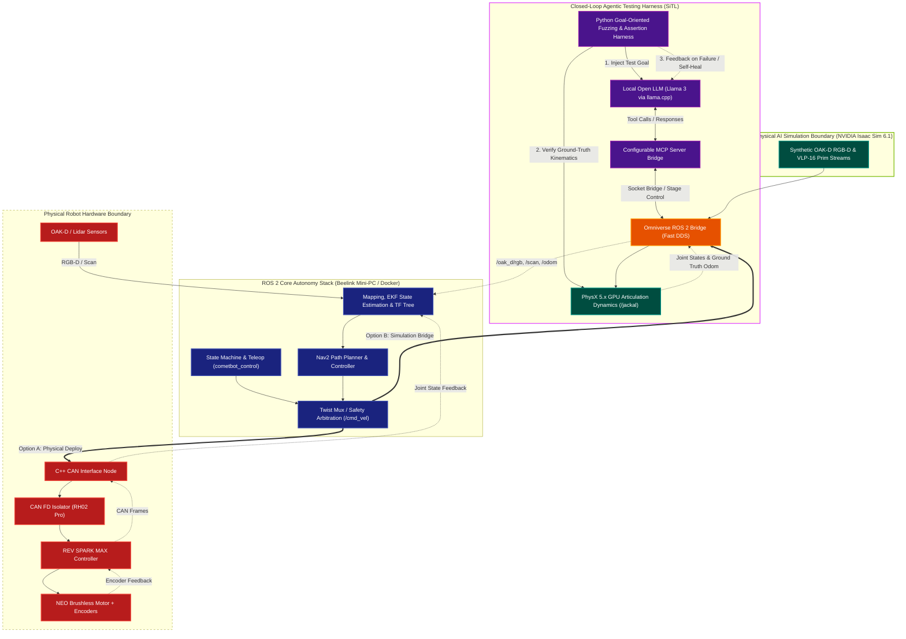
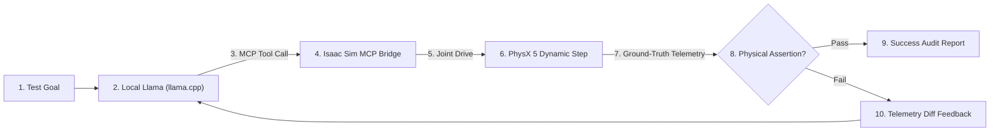
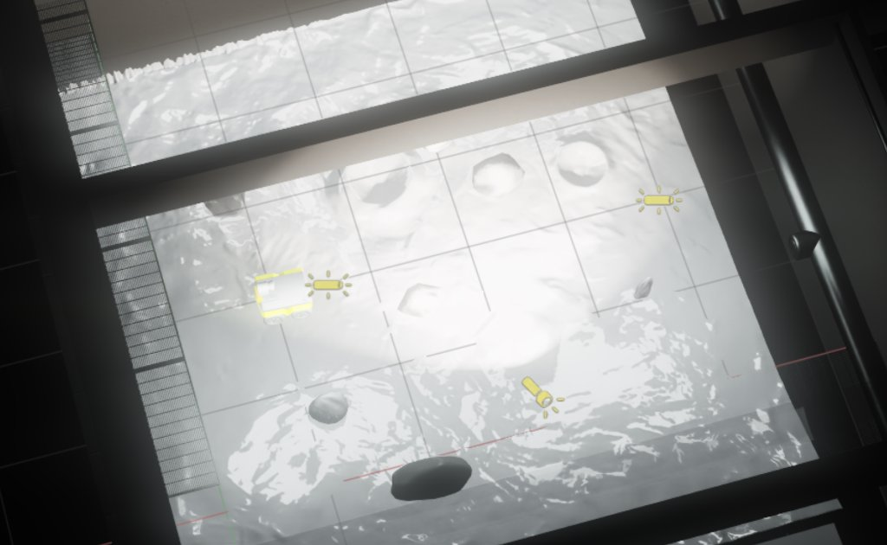
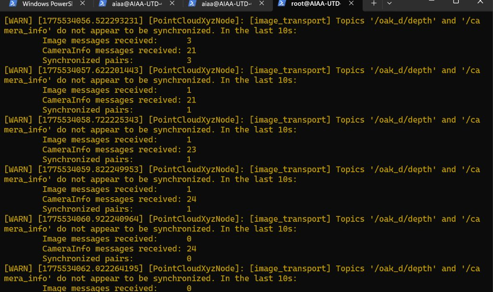

# AIAA Isaac Sim Rover

A reproducible workflow bridging NVIDIA Isaac Sim 6.1 with ROS 2 Humble for autonomous planetary rovers.

## Highlights

* **Closed-loop simulation testing:** An agentic test harness connects a local Llama model (served with `llama.cpp`) to Isaac Sim via Model Context Protocol (MCP) tools. It commands test maneuvers, checks whether the rover actually moves forward in PhysX without tipping, and feeds back telemetry if an assertion fails so the model can adjust parameters.
* **Hardware vs. simulation boundary:** The autonomy stack runs identical ROS 2 nodes whether driving the physical rover or running in simulation. The boundary is drawn at `/cmd_vel`: on the physical robot, commands route to a C++ SocketCAN driver controlling REV SPARK MAX motor controllers; in simulation, they route through the Omniverse ROS 2 Bridge to drive Isaac Sim wheel joints.
* **Synthetic perception:** Streams 20 Hz OAK-D camera feeds and VLP-16 lidar scans into ROS 2 over Fast DDS, matching the physical robot's sensor topics.
* **Terrain physics:** Runs in Isaac Sim 6.1 on a 1 cm DEM lunar ground mesh with PhysX GPU dynamics and an optional sand-rut deformation model.
* **Performance:** Sustained **60 FPS simulation** (PhysX 5 GPU dynamic broadphase at 60 Hz physics steps) and **30 FPS edge processing** on Beelink mini-PC / Jetson.
* **Verified on:** NVIDIA RTX 4080 (Driver 550+), Isaac Sim 6.1, ROS 2 Humble (Fast DDS), Windows 11 with WSL 2 Ubuntu 22.04.

---

## System Architecture

The autonomy stack runs identically on both targets. The boundary sits at `/cmd_vel` for actuation and the camera/lidar topics for feedback:



---

## Closed-Loop Agentic Testing (SiTL)

The [`agentic/`](agentic/README.md) directory contains a simulation-in-the-loop testing harness connecting a local Llama model to Isaac Sim using the Model Context Protocol (MCP):

* **Tool execution via MCP:** The model inspects the USD stage and commands joint velocity using standard MCP tools (compatible with [`isaacsim-mcp-server`](https://github.com/whats2000/isaacsim-mcp-server) or custom tool servers).
* **Ground-truth physical assertions:** The harness steps PhysX dynamics and validates that commanded wheel velocity actually moves the chassis forward along the +X axis without tipping over.
* **Iterative self-healing:** When physical assertions fail (e.g. low drive torque, wheel slippage, or collision snags), telemetry diffs are piped back to the model for automated parameter correction.



```powershell
# Run task passes: drive, onboarding stage audit, or camera sync
py agentic/sitl_harness.py --task drive
py agentic/sitl_harness.py --task onboarding
py agentic/sitl_harness.py --task camera

# Run harness unit and regression tests (passed 5/5 in 0.04s)
py -m pytest tests/test_agentic_harness.py
```
> For `llama.cpp` setup and MCP configuration details, see the **[Agentic SiTL Guide](agentic/README.md)**.

---

## Prerequisites & Environment

* **Host OS:** Windows 10/11 with WSL 2 (Ubuntu 22.04)
* **GPU:** NVIDIA RTX (Driver 535+)
* **Simulation:** NVIDIA Isaac Sim 6.1
* **Container Runtime:** Docker Desktop with WSL 2 integration
* **ROS 2:** Humble (`rmw_fastrtps_cpp`, Domain 0)
* **Optional Hardware:** REV SPARK MAX motor controller + USB-to-CAN adapter

---

## Quickstart: Running the Simulation

From PowerShell in the repository root:

```powershell
# 1. Inspect WSL, Docker, and USB joystick availability
.\scripts\windows\start_rover_all.ps1 -Mode Diagnostics

# 2. Start/reuse the ROS 2 container and open the canonical scene in Isaac Sim
.\scripts\windows\start_rover_all.ps1
```

Once Isaac Sim opens:
1. Press **Play** (or spacebar) in Isaac Sim to start the PhysX simulation and ROS 2 bridges.
2. Drive the rover using a gamepad or terminal keyboard fallback:

```bash
# Drive with terminal keyboard (no gamepad required)
ros2 run teleop_twist_keyboard teleop_twist_keyboard
```

To stop teleop nodes while leaving Isaac Sim open:
```powershell
.\scripts\windows\stop_rover.ps1
```

---

## Expected Results & Verification

Verify active topic rates and data across the Fast DDS bridge:

| Stream / Topic | Expected Rate | Expected Data | Verification Command |
| :--- | :--- | :--- | :--- |
| `/scan` | ~20 Hz | 360° laser scan ranges (VLP-16) | `ros2 topic hz /scan` |
| `/oak_d/rgb/image_raw` | ~20 Hz | 640×400 raw color frames | `ros2 topic hz /oak_d/rgb/image_raw` |
| `/cmd_vel` $\to$ Articulation | Real-time | Joint motion on four wheel prims | Inspect Isaac Sim viewport |
| `/tf` | ~20–60 Hz | Coordinate transforms (`odom` $\to$ `base_link`) | `ros2 run tf2_ros tf2_echo odom base_link` |

### Visual Verification

**Isaac Sim Viewport (Rover on Lunar DEM Terrain):**


**Point Cloud & Camera Synchronization Diagnostics:**


---

## Hands-On Onboarding ("Try It Yourself")

For a guided walkthrough, explore the **[Onboarding Lessons](lessons/README.md)**:
* **[Lesson 01: OpenUSD Scene Composition & PhysX Dynamics](lessons/01_sim_environment.md)**
* **[Lesson 02: ROS 2 Bridging & Dual-Target Autonomy](lessons/02_ros2_teleop.md)**
* **[Lesson 03: Closed-Loop Agentic Testing (SiTL)](lessons/03_agentic_testing.md)**

### Quick Exercises
1. **Drive Parameter Assertion:** Open `agentic/tasks/wheel_motion.py`, change `min_displacement_expected` from `0.15` to `2.0`, and run `py agentic/sitl_harness.py --task drive`. Observe how the test fails on iteration 1 and how the harness returns the displacement deficit to the model for self-healing.
2. **Camera Desync Resolution:** Run `py agentic/sitl_harness.py --task camera` to audit the `/ActionGraph` render product resolution (640×400) and ensure both depth and camera_info helpers are sharing the active tick and render product.

### Knowledge Check
* *Why must the terrain collider use `physics:approximation = "none"` instead of a convex hull?*  
  *(Answer: A convex hull wraps outer vertices, bridging craters and causing the rover to float above depressions. Triangle mesh contact allows wheels to track exact terrain contours.)*
* *What causes `[PointCloudXyzNode] Topics '/oak_d/depth' and '/camera_info' do not appear to be synchronized`?*  
  *(Answer: Topic namespace mismatch—subscribing to `/camera_info` instead of `/oak_d/camera_info`—or timestamp jitter between render product frames and camera info helpers.)*

---

## Learner Feedback & Usability Log

To ensure this repository serves as an effective learning resource, we tested the quickstart cold with student engineers and interns. Key improvements made from learner feedback:
1. **Zero-Hardware Teleop:** Added the `teleop_twist_keyboard` command so developers without a physical gamepad can test motion immediately.
2. **WSL Device Permissions:** Fixed `/dev/input/js0` permissions inside Docker containers on Windows/WSL 2 to eliminate joystick bind errors.
3. **Isaac Sim Play Cue:** Clarified that Isaac Sim's timeline must be running (**Play** button active) for Action Graph subscribers to receive commands.

---

## Troubleshooting

| Symptom | First Check | Resolution |
| :--- | :--- | :--- |
| **Rover does not move on `/cmd_vel`** | Isaac Sim is paused | Click **Play** in Isaac Sim; confirm `ROS_DOMAIN_ID=0` matches across host and Docker. |
| **No gamepad detected** | WSL 2 `/dev/input/js0` missing | Run the keyboard teleop fallback: `ros2 run teleop_twist_keyboard teleop_twist_keyboard`. |
| **Lidar `/scan` topic empty** | Sensor Action Graph disabled | Inspect `/jackal/ActionGraph` in Isaac Sim and verify `LiDARGraph` is enabled. |
| **Images absent or wrong** | Camera render product uncomposed | Check OAK camera prim `/jackal/base_link/camera` resolution (640×400) and viewport pipeline. |

---

## Subsystem Reference

| Need | Read first | Authoritative file or prim |
| :--- | :--- | :--- |
| Scene layout, ownership, and variants | [Architecture](docs/architecture.md), [scenes](scenes/README.md) | Saved USD stage |
| Elevation, rocks, contact, and sand ruts | [Terrain](docs/terrain.md), [environment](docs/environment.md) | `config/terrain.yaml`, `/Lunalab/Terrain/terrain_mesh` |
| Rover mass, wheels, and drive mechanics | [Rover](docs/rover.md), [Action Graphs](docs/isaac/action-graph.md) | `/jackal`, `/jackal/ActionGraph` in USD |
| RGB/depth, lidar, TF, and clock | [Sensors](docs/sensors.md) | Camera/lidar prims and USD graphs |
| Controller mapping and ROS topics | [ROS 2](docs/ros2.md) | `config/{joy,controller,ros}.yaml`, `cometbot_control` |
| Startup and shutdown | [Launch guide](docs/setup/launch.md), [Windows scripts](scripts/windows/README.md) | `scripts/windows/` |
| Tests and performance benchmarks | [Tests](tests/README.md), [performance](docs/performance-analysis.md), [known issues](docs/known-issues.md) | Validators and recorded measurements |
