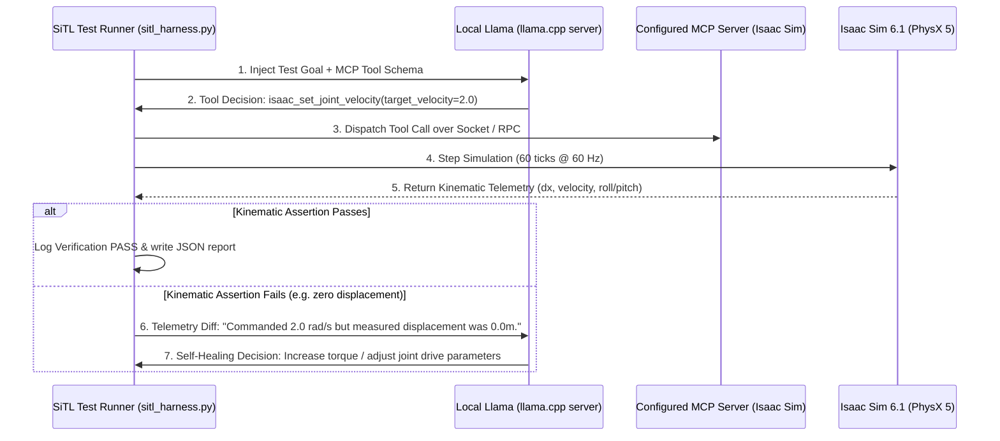

# Closed-Loop Agentic Testing Harness (SiTL)

This directory provides a Simulation-in-the-Loop (SiTL) test harness connecting local open-weights foundation models to NVIDIA Isaac Sim 6.1 via the Model Context Protocol (MCP).

---

## How It Works

Instead of static unit tests, this harness uses a local Llama model as an automated testing agent:
1. **Goal injection**: The harness defines a physical test objective (e.g. *"Drive forward at 2.0 rad/s on LunaLab DEM terrain and assert positive linear displacement without chassis instability"*).
2. **Tool execution via MCP**: The model selects and calls MCP tools (such as `isaac_set_joint_velocity`, `isaac_step_simulation`) to interact with the active USD stage in Isaac Sim.
3. **Ground-truth physical assertions**: The harness inspects live PhysX 5 dynamics (linear velocity, displacement, roll/pitch stability).
4. **Iterative feedback**: If an assertion fails (e.g. chassis snagged on terrain or insufficient drive torque), the harness captures the telemetry diff and prompts the model to correct its parameters.



---

## Setup Guide

### 1. Set Up Local Inference (`llama.cpp` or LM Studio)
The harness works with any OpenAI-compliant local server. It is optimized for open-weights models running within a **16GB VRAM** workstation budget (e.g. NVIDIA RTX A4000), leaving ample headroom for Isaac Sim's GPU PhysX dynamics and RTX viewport:

* **NVIDIA Nemotron (First-Class NVIDIA Open Models):**
  * `Llama-3.1-Nemotron-8B-Instruct.Q4_K_M.gguf` (~4.8 GB weights) — Takes <5 GB VRAM, leaving ~11 GB VRAM free on a 16GB card for Isaac Sim rendering and PhysX simulation.
  * `Nemotron-Mini-4B-Instruct.Q4_K_M.gguf` (~2.5 GB weights) — Ultra-low latency tool calling footprint.
* **Meta Llama & Qwen:**
  * `Meta-Llama-3-8B-Instruct.Q4_K_M.gguf` (~4.8 GB)
  * `Qwen2.5-7B-Instruct` / `Qwen2.5-32B` (with partial offload or MoE quants)

**Launch with `llama.cpp` (CLI / Headless):**
```bash
# Example with NVIDIA Nemotron 8B:
llama-server -m models/Llama-3.1-Nemotron-8B-Instruct.Q4_K_M.gguf --port 8080 -ngl 99
```
The server will be live and serving at `http://127.0.0.1:8080/v1`.

**Launch with LM Studio (GUI):**
Load your model (`Llama-3.1-Nemotron-8B`, `Meta-Llama-3-8B`, or `Qwen`), connect the `mcp/isaac-sim` tool server, and start the local inference server on port `8080` (or `1234`).

*(Documentation reference: [llama.cpp HTTP server docs](https://github.com/ggerganov/llama.cpp/tree/master/examples/server) / [LM Studio](https://lmstudio.ai/))*

---

### 2. Configure Your MCP Server(s)
Once the `llama.cpp` server is running, you can attach any Model Context Protocol (MCP) server your workflow requires:

* **Isaac Sim MCP Server**: Connect to the simulation environment using [`whats2000/isaacsim-mcp-server`](https://github.com/whats2000/isaacsim-mcp-server):
  ```powershell
  python -m isaacsim_mcp_server --port 8211
  ```
* **Extensible Tool Registry**: The harness is designed modularly—you can configure additional custom MCP servers (e.g. CAN bus diagnostics, telemetry parsers, or ROS 2 introspectors) into `IsaacSimMCPBridge` simply by passing their tool schemas and socket endpoints.

---

### 3. Run the SiTL Verification Harness

The harness is modular: `GenericAgenticHarness` accepts any task subclassing `AgenticTask`. Three versioned tasks are included in `agentic/tasks/`:

* **`drive` (`wheel_motion`):** Commands wheel joints on `/jackal` and validates forward PhysX displacement.
* **`onboarding` (`onboarding_audit`):** Developer onboarding task. Audits the stage to ensure `/jackal` has rigid body physics, 4 revolute joints, valid mass (45–65 kg), and static triangle mesh terrain collision.
* **`camera` (`camera_sync`):** Diagnoses the `PointCloudXyzNode` warning where `CameraInfo` publishes without paired depth frames. Audits render products, 640×400 resolution, and clock synchronization.

From the repository root:

```powershell
# Run the wheel drive task
py agentic/sitl_harness.py --task drive

# Run the developer onboarding stage audit
py agentic/sitl_harness.py --task onboarding

# Run the camera and depth synchronization check
py agentic/sitl_harness.py --task camera

# Run with a live local llama.cpp server
py agentic/sitl_harness.py --task drive --endpoint "http://127.0.0.1:8080/v1" --mock-sim=false
```

To run automated unit and regression tests across the task suite:
```powershell
py -m pytest tests/test_agentic_harness.py
```

---

## Sample Output & Verification Report

When executed, the harness generates an audit report at `work/sitl_test_report.json`:

```json
{
  "goal": "rover_forward_kinematic_check",
  "overall_success": true,
  "iterations_taken": 1,
  "final_displacement_m": 0.500,
  "attempts": [
    {
      "iteration": 1,
      "agent_decision": {
        "tool": "isaac_set_joint_velocity",
        "arguments": {
          "joint_names": [
            "front_left_wheel_joint",
            "front_right_wheel_joint",
            "rear_left_wheel_joint",
            "rear_right_wheel_joint"
          ],
          "target_velocity": 2.0
        }
      },
      "displacement_m": 0.500,
      "speed_mps": 0.500,
      "passed": true,
      "failure_reasons": []
    }
  ]
}
```
