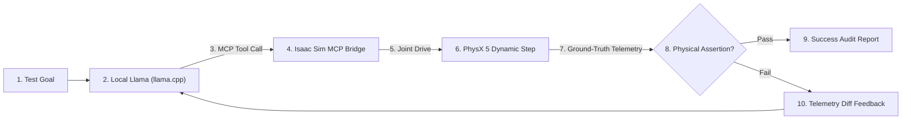

# Lesson 03: Closed-Loop Agentic Testing (SiTL)

## Overview
In this lesson, you will learn how to pair local open-weights language models (via `llama.cpp`) with NVIDIA Isaac Sim using the Model Context Protocol (MCP) to run automated, physics-grounded simulation tests.

---

## 1. Key Concepts

### Grounded Physical Assertions vs. Blind Generation
Traditional automated tests in simulation are brittle and require hard-coding every permutation. Raw LLM code generation, on the other hand, frequently hallucinates ungrounded parameters.

Our **Simulation-in-the-Loop (SiTL)** harness bridges these paradigms:
1. The harness presents a high-level test objective to the model.
2. The model commands simulation tools via standard MCP interfaces (e.g. `isaac_set_joint_velocity`).
3. The harness advances PhysX dynamics and evaluates ground-truth kinematic metrics.
4. If an assertion fails, the telemetry diff is returned to the model for automated self-healing.



---

## 2. Guided Exercise: Running and Extending an Agentic Task

### Step 1: Run the Default Wheel Drive Task
From the repository root:
```powershell
py agentic/sitl_harness.py --task drive
```

Observe the test log:
1. Baseline telemetry is sampled (`start_x`).
2. The agent selects `isaac_set_joint_velocity` with `target_velocity: 2.0`.
3. PhysX advances 60 ticks (1.0 second).
4. Forward displacement is verified ($dx \ge 0.15\text{ m}$) and chassis stability is checked (roll/pitch $< 25^\circ$).

### Step 2: Inspect the Output Audit Report
Open `work/sitl_test_report.json` to review the structured results:
```json
{
  "task_id": "wheel_motion",
  "overall_success": true,
  "iterations_taken": 1,
  "final_metrics": {
    "displacement_m": 0.500,
    "linear_speed_mps": 0.500,
    "roll_deg": 0.0,
    "pitch_deg": 1.2
  }
}
```

---

## 3. Hands-On Experiment ("Try It Yourself")

### Experiment: Inducing an Assertion Failure & Triggering Self-Healing
* **Action**: Open `agentic/tasks/wheel_motion.py`. Change `min_displacement_expected = 5.0` (an impossible distance to cover in 1 second at normal drive speed).
* **Prediction**: What will happen on Iteration 1? How will the harness communicate the failure to the model?
* **Run**:
  ```powershell
  py agentic/sitl_harness.py --task drive --max-retries 3
  ```
* **Observe**:
  * Iteration 1 fails: `Displacement 0.500m below minimum threshold 5.000m`.
  * The harness constructs a feedback prompt containing the measured deficit.
  * On Iteration 2, the agent attempts to increase drive velocity (`target_velocity = 4.0`).

---

## 4. Knowledge Check

**Question 1**: Why is telemetry feedback (the difference between commanded velocity and measured displacement) provided back to the model rather than just raising a standard Python `AssertionError`?
<details>
<summary>Answer</summary>
Returning structured telemetry turns a binary test failure into an actionable engineering problem. It gives the agent the physical context needed to reason about whether the issue was low torque, excessive friction, or a collision snag, enabling automated parameter remediation.
</details>

**Question 2**: How does the Model Context Protocol (MCP) protect against unsafe or destructive simulation modifications?
<details>
<summary>Answer</summary>
MCP restricts the model's interactions to a strict, typed tool schema (e.g. predefined setters, inspectors, and step commands). The model cannot execute arbitrary shell commands or corrupt unexposed files.
</details>
